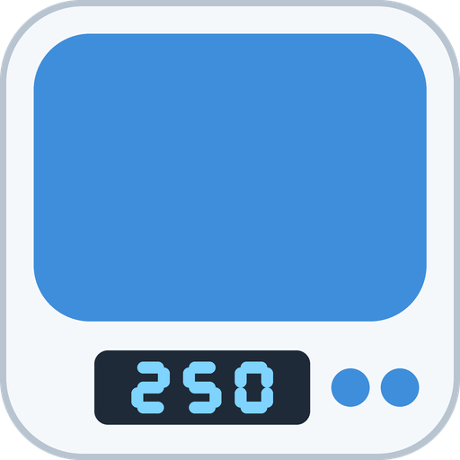

<p align="center">
  <picture>
    <source media="(prefers-color-scheme: dark)" srcset="custom_components/chipsea_scale/brand/dark_icon@2x.png">
    
  </picture>
</p>

# Chipsea Scale for Home Assistant

[![GitHub Release][releases-shield]][releases]
[![Validate][validate-shield]][validate]
[![Tests][tests-shield]][tests]
[![License][license-shield]](LICENSE)

[](https://my.home-assistant.io/redirect/hacs_repository/?owner=miguelangel-nubla&repository=homeassistant_chipsea_scale&category=integration)

Bring the weight on your Bluetooth kitchen scale into Home Assistant as it changes. Works with scales built on the Chipsea chipset, such as:

- Scales advertising as `Chipsea-BLE`
- SmartChef kitchen scales
- ProfiCook PC-KW scales
- Other scales advertising the Chipsea Bluetooth manufacturer ID (4298)

## Features

- **Automatic discovery** of scales over Bluetooth, including through ESPHome Bluetooth proxies
- **Instant readings**: the scale pushes every weight change; nothing is polled
- **Any display unit**: readings in g, kg, lb or oz are all reported in grams
- **Honest availability**: the sensor is unavailable while the scale sleeps and returns as soon as it wakes up
- **Battery friendly**: connects only while the scale is advertising, and keeps retrying while it is awake so a failed attempt never leaves it disconnected

## How it works

The scale is off most of the time. When you put something on it, it wakes up and starts advertising over Bluetooth. Home Assistant notices, connects (directly or through an ESPHome Bluetooth proxy) and subscribes to weight updates. Every change on the display then reaches Home Assistant within moments. When the scale turns itself off, the connection drops and the sensor becomes unavailable until the next time it wakes up.

The integration never wakes the scale and never polls it, so it does not affect battery life.

## Installation

### Home Assistant Marketplace

1. Click the button above, or in Home Assistant go to **Settings** → **Marketplace**, add `https://github.com/miguelangel-nubla/homeassistant_chipsea_scale` as a custom repository of type **Integration**, and open it.
2. Click **Download**.
3. Restart Home Assistant.

On Home Assistant versions before 2026.11, the same steps work in HACS.

### Manual

1. Download the latest release from the [releases page][releases].
2. Copy the `custom_components/chipsea_scale` folder into your Home Assistant `config/custom_components` folder.
3. Restart Home Assistant.

## Configuration

Wake the scale by placing something on it. Home Assistant usually discovers it on its own and shows a notification under **Settings** → **Devices & services**. You can also add it yourself:

1. Go to **Settings** → **Devices & services** → **Add integration** and search for **Chipsea Scale**.
2. Pick your scale from the list, or choose **Enter address manually** and type its Bluetooth address (for example `AA:BB:CC:DD:EE:FF`).

A scale added by address can be set up while it is asleep. It connects the next time it wakes up.

## Entities

| Entity | Description |
| --- | --- |
| Weight | Current weight in grams. Unavailable while the scale is asleep or until the first reading after it wakes up. |

The weight sensor also has these attributes:

| Attribute | Description |
| --- | --- |
| `scale_unit` | Unit shown on the scale's display (`g`, `kg`, `lb` or `oz`) |
| `raw_weight` | Weight as shown on the display, in `scale_unit` |
| `decimal_places` | Decimal places shown on the display |
| `is_stable` | Whether the scale reports the reading as settled |
| `last_measurement` | When the reading arrived |

`raw_weight` and `last_measurement` change with almost every reading, so they are not stored in the recorder history.

## Examples

Notify when something placed on the scale has settled:

```yaml
automation:
  - alias: "Announce weighed item"
    triggers:
      - trigger: state
        entity_id: sensor.chipsea_ble_weight
        attribute: is_stable
        to: true
    conditions:
      - condition: numeric_state
        entity_id: sensor.chipsea_ble_weight
        above: 5
    actions:
      - action: notify.notify
        data:
          message: "Weighed {{ states('sensor.chipsea_ble_weight') | round(0) }} g"
```

Track how much coffee is left in a container on the scale, ignoring readings while it is being moved:

```yaml
template:
  - triggers:
      - trigger: state
        entity_id: sensor.chipsea_ble_weight
        attribute: is_stable
        to: true
    sensor:
      - name: "Coffee beans left"
        unit_of_measurement: g
        device_class: weight
        state: "{{ [states('sensor.chipsea_ble_weight') | float(0) - 350, 0] | max | round(0) }}"
```

Replace `sensor.chipsea_ble_weight` with your sensor's entity ID, and `350` with the weight of your empty container.

## Known limitations

- Readings are only available while the scale is on. Its own auto-off timer decides when it sleeps.
- Tare, unit changes and power are controlled on the scale only. The protocol has no known commands for them.
- Readings above 5 kg are discarded as corrupt, which matches the capacity of supported kitchen scales.
- Each scale can be connected to only one device at a time. Close the manufacturer's app if Home Assistant cannot connect.

## Troubleshooting

**The scale is not discovered**
- Make sure the scale is on. Most scales only advertise for a short time after they wake up.
- Make sure a Bluetooth adapter or an ESPHome Bluetooth proxy that supports active connections is within range.
- Add the scale manually by its Bluetooth address.

**The sensor is unavailable**
- This is normal while the scale is off or asleep. It becomes available again with the first reading after it wakes up.
- The integration logs a single message when it cannot connect to an awake scale, and another when it is back online.

**Diagnostics**
Go to **Settings** → **Devices & services** → **Chipsea Scale** → ⋮ → **Download diagnostics**. The file includes connection statistics and the last reading. The Bluetooth address is redacted. For more detail, enable debug logging on the same page and reproduce the problem.

## Removing the integration

1. Go to **Settings** → **Devices & services** → **Chipsea Scale**, open the ⋮ menu of the scale and select **Delete**.
2. To remove the files too, uninstall it from **Settings** → **Marketplace**, or delete the `custom_components/chipsea_scale` folder, and restart Home Assistant.

## Development

```bash
python3.14 -m venv .venv
.venv/bin/pip install -r requirements_test.txt
.venv/bin/pytest --cov
ruff check . && ruff format --check .
```

The protocol is described in [PROTOCOL.md](protocol_notes.txt).

## Contributing

Issues and pull requests are welcome. Please check the [issue tracker][issues] first.

## License

MIT. See [LICENSE](LICENSE).

[releases-shield]: https://img.shields.io/github/release/miguelangel-nubla/homeassistant_chipsea_scale.svg?style=for-the-badge
[releases]: https://github.com/miguelangel-nubla/homeassistant_chipsea_scale/releases
[validate-shield]: https://img.shields.io/github/actions/workflow/status/miguelangel-nubla/homeassistant_chipsea_scale/validate.yaml?branch=master&label=validate&style=for-the-badge
[validate]: https://github.com/miguelangel-nubla/homeassistant_chipsea_scale/actions/workflows/validate.yaml
[tests-shield]: https://img.shields.io/github/actions/workflow/status/miguelangel-nubla/homeassistant_chipsea_scale/tests.yaml?branch=master&label=tests&style=for-the-badge
[tests]: https://github.com/miguelangel-nubla/homeassistant_chipsea_scale/actions/workflows/tests.yaml
[license-shield]: https://img.shields.io/github/license/miguelangel-nubla/homeassistant_chipsea_scale.svg?style=for-the-badge
[issues]: https://github.com/miguelangel-nubla/homeassistant_chipsea_scale/issues
